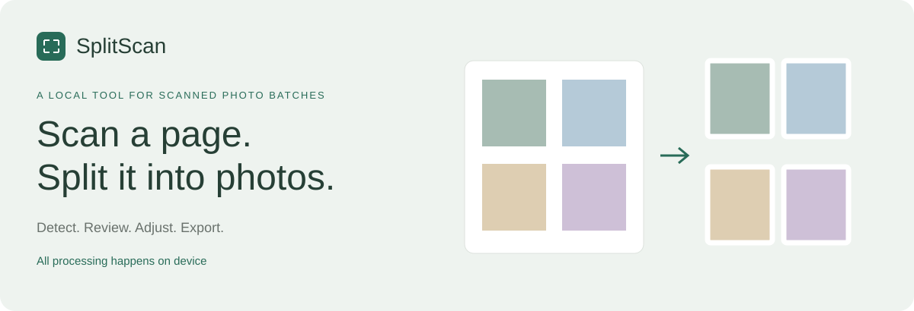
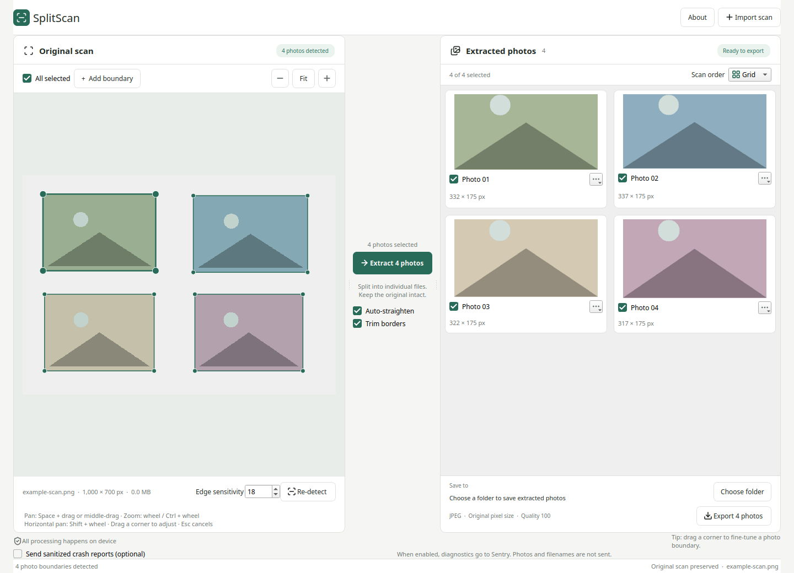

<p align="center">
  
</p>

<p align="center">
  A local desktop application for detecting, reviewing, straightening, and exporting scanned photographs.
</p>

<p align="center">
  <a href="https://github.com/fvclaus/splitscan/releases/latest">Latest downloads</a> &nbsp;·&nbsp;
  <a href="#import-check-export">How it works</a> &nbsp;·&nbsp;
  <a href="#privacy">Privacy</a> &nbsp;·&nbsp;
  <a href="#run-from-source">Run from source</a>
</p>



## Import, check, export.

| 01 · Import a scan | 02 · Review the boundaries | 03 · Export individual files |
| --- | --- | --- |
| Scan several prints together, then import one JPEG, PNG, TIFF, or BMP. SplitScan detects candidate photo outlines. | If selected photos need attention, choose **Review boundaries**. Confirm each valid suggestion, drag corners to correct it, or exclude it. Invalid outlines require correction, not just confirmation. | Choose **Extract photos** to see previews and pixel dimensions, then export selected crops to a folder. Your original scan is never changed. |

**Fine-tune every edge.** Drag a corner to adjust an outline; a floating 3× loupe helps align it.
Use **Add boundary** for a missed photo. Click an outline to include or exclude it.
Review navigation does not change which photos you have included.
After the last review, extraction is available again; it does not start automatically.

**Navigate the canvas.**

| Action | Gesture |
| --- | --- |
| Pan | Hold **Space** and left-drag, or middle-mouse drag |
| Scroll vertically | Mouse wheel |
| Zoom | **Ctrl + wheel**, or the zoom buttons |
| Scroll horizontally | **Shift + wheel** |
| Return to the whole scan | **Fit** |
| Cancel a corner drag | **Escape** |

Auto-straighten and border trimming are enabled by default. Changing boundaries or processing
options clears stale previews. Adjust edge sensitivity and re-detect if needed.
**Cancel processing** stops between processing stages, not during an OpenCV operation.
The output folder is remembered between scans and launches.

## Alternatives and complementary tools

SplitScan can replace the **post-scan photo splitting step**, not an entire commercial
scanning suite. Acquire a full-bed scan with free, open-source software such as
[NAPS2](https://www.naps2.com/) on Windows, macOS, or Linux, or use your existing
scanner software. Save it as PNG, TIFF, or JPEG, then import it into SplitScan.
Your scanner still needs a compatible driver or scanning backend; SplitScan does
not control scanners or import PDFs.

### Commercial desktop apps

| Application | What SplitScan can replace | Features outside SplitScan's scope |
| --- | --- | --- |
| [AutoSplitter](https://autosplitter.com/) | Separating photos from an existing scan, reviewing and adjusting crops, straightening, and exporting individual JPEGs. | Direct scanning, color restoration, captions, and metadata editing. |
| [ScanSpeeder](https://scanspeeder.com/) | Separating photos from an imported scan, adjusting crops, straightening, and exporting individual JPEGs. | Scanner/feeder/film acquisition, photo enhancement, captions/tags, bulk workflows, and archival/high-bit-depth output capabilities. |

### GitHub CLI and script tools

| Project | Overlapping workflow | Key distinction |
| --- | --- | --- |
| [alexhorn/AutoCrop](https://github.com/alexhorn/AutoCrop) | Cropping multiple photos from one scan. | A Python CLI requiring ImageMagick 6; SplitScan provides visual boundary review and corner editing. |
| [hspedro/crop-scanned-photos](https://github.com/hspedro/crop-scanned-photos) | Detecting and cropping multiple photos against a white scanner background. | Offers folder processing, configurable thresholds, and threading; SplitScan processes one scan at a time interactively. |
| [bozjator/auto-scan-splitter](https://github.com/bozjator/auto-scan-splitter) | Splitting and deskewing multi-photo scans. | Includes Linux folder watchers, services, and SMB/NAS transfer queues, which SplitScan does not provide. |

[z80z80z80/autocrop](https://github.com/z80z80z80/autocrop) is related but expects
**one photo per scan**, roughly cropped beforehand; it crops and rotates those images
rather than separating a multi-photo scan.

These comparisons describe feature scope based on the linked product documentation
and project READMEs, not measured detection accuracy or performance. SplitScan exports
lossy JPEGs and does not replace lossless/high-bit-depth archival workflows.


## Privacy

**All processing happens on device.** Scans and extracted photos are not uploaded.

Usage statistics and sanitized crash reports are **independent, optional, and off by default**.
On first launch, SplitScan asks you to choose whether to enable either option. Saving your
choices remembers them, including declining both. Closing the dialog without saving keeps
reporting inactive for that launch and asks again next launch. Change either choice anytime
in **Settings**, beside **About**.

If you enable usage statistics, Sentry receives events for opening the app, loading a scan,
committing a valid border correction, successfully extracting photos, and successfully saving
photos. Events include only the interaction name, photo count for extraction/save batches,
application version, and operating system, plus event identifiers and timestamps. No user or
device identifiers are collected. Re-detection, mouse movements, failed/cancelled operations,
and cancelled border edits are not counted.

If you enable crash reporting,
sanitized error diagnostics are sent to Sentry: exception types, application stack locations,
application version, and operating system. Photos, image arrays, filenames, user paths,
exception messages, and sensitive breadcrumbs are stripped.
Only these crash diagnostics use Sentry's **Issues** ingestion. Usage issues sent by
older app versions remain in Sentry until you resolve or remove them there; this change
does not modify existing Sentry data.

Neither option sends photos, image data, filenames, or user paths. Disabling an option stops
future reports and discards pending telemetry from the previous configuration; requests
already in flight cannot be recalled. Network services can still observe connection metadata
such as the source IP.

## Output and limitations

- JPEG exports use encoder quality **100**, without downscaling. Output pixel dimensions derive
  from the selected boundary. JPEG re-encoding is lossy; this is not lossless archival output.
- Existing files are never overwritten.
- OpenCV contour detection is primary; watershed attempts to split likely touching photos.
  Uncertain suggestions require explicit review. Difficult arrangements may need manual boundaries.
- One scan at a time. No SAM backend, multi-scan queue, or non-JPEG export.
- Large scans can require significant memory. Validate results against your real scans.
- Settings use Qt's platform-standard store. The legacy `Keepsake/PhotoSplitter` settings namespace
  is retained so existing output-folder and threshold preferences survive the rebrand.
- macOS downloads are not Developer ID signed or notarized. Gatekeeper may require an explicit
  per-app approval through macOS Privacy & Security after you verify the download.
  Windows may also warn about an unsigned application. Do not disable system-wide protections.
- Linux archives expect the system's graphics/X11 runtime libraries. On Ubuntu 22.04, install
  `libegl1 libgl1 libxkbcommon0 libdbus-1-3 libxcb-cursor0 libxcb-icccm4 libxcb-keysyms1
  libxcb-shape0 libxcb-xinerama0 libxcb-xkb1 libxkbcommon-x11-0` if they are missing.

## Run from source

Use Python 3.11 or newer for the tested release build toolchain:

```sh
python -m venv .venv
. .venv/bin/activate
python -m pip install -e '.[test]'
photo-splitter
```

On Windows, activate with `.venv\Scripts\activate`.
The existing `photo-splitter` command and `photo_splitter` package name are intentionally retained.

With `uv`:

```sh
uv venv .venv
uv pip install --python .venv/bin/python -e '.[test]'
.venv/bin/photo-splitter
```

## Development and releases

```sh
pytest
photo-splitter --version
photo-splitter --smoke-test
```

Tests exercise detection, invalid/uncertain boundaries, guided review, editing and loupe behavior,
pan/zoom gestures, crop/export safety, privacy consent, usage event counts, and telemetry sanitization.
Headless Qt tests use the offscreen platform; telemetry tests never send real events.

GitHub Actions validate pushes and pull requests with native builds and packaged smoke tests.
CI uses pinned uv for dependency installation and the custom macOS OpenCV wheel build,
while retaining the pinned Python interpreter and requirements files.
Version tags build release artifacts; publication is gated on successful builds and license checks.
The version is included in the app and download filenames.
See [distribution instructions](docs/DISTRIBUTION.md) for the supported build baseline,
packaging, license inventory, and shared-library replacement/source information.

## License

SplitScan's project-owned code and original README graphics are [MIT licensed](LICENSE),
© 2026 fvclaus and SplitScan contributors. Third-party components retain their own licenses,
including LGPL-covered PySide6/Qt. Downloads include third-party license notices and
corresponding-source information; the MIT license does not replace those obligations.
